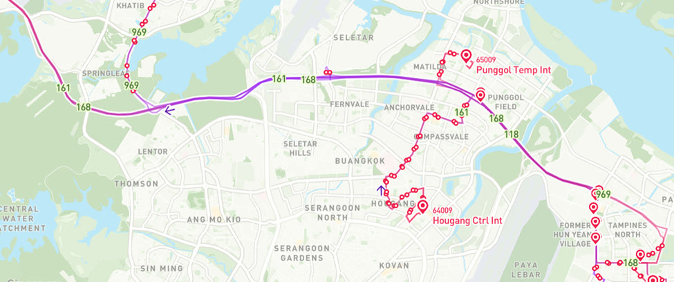
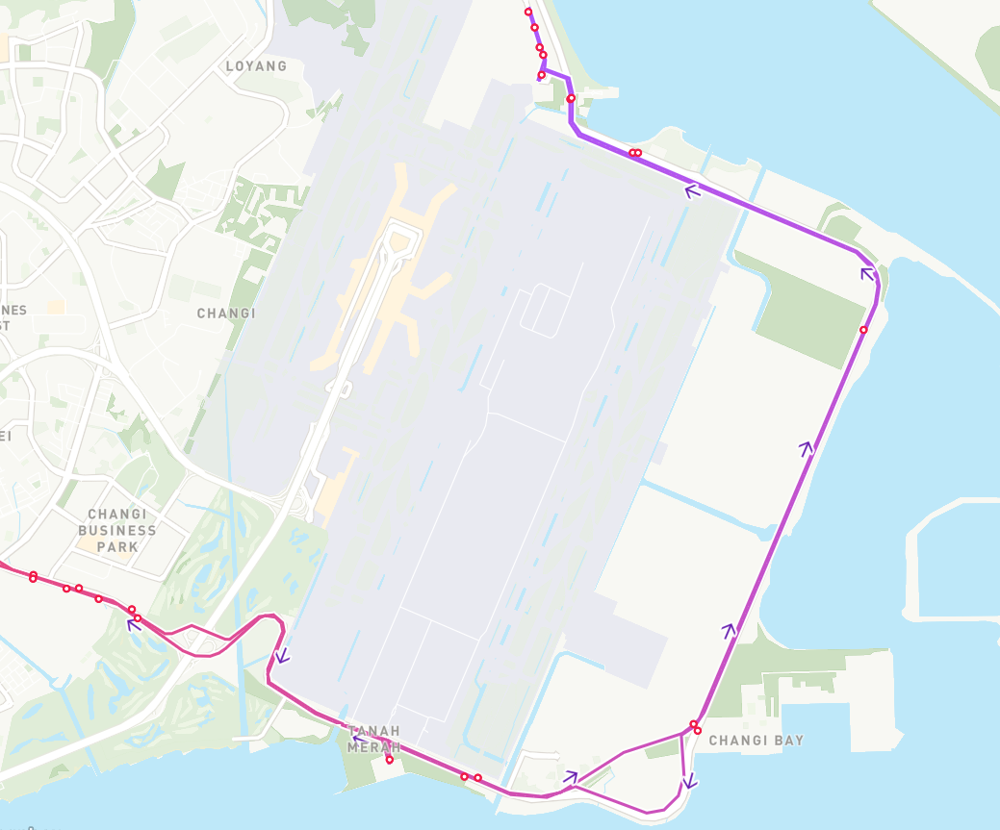
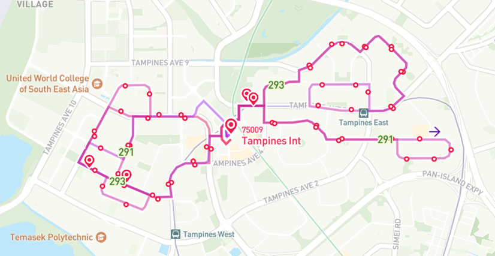
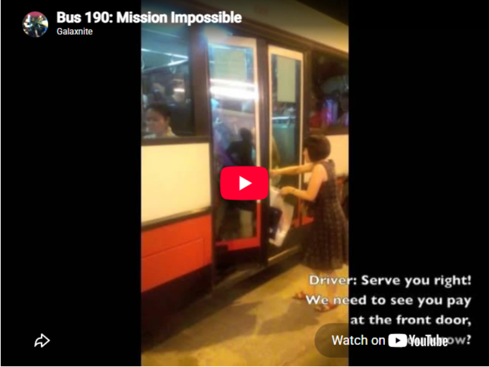
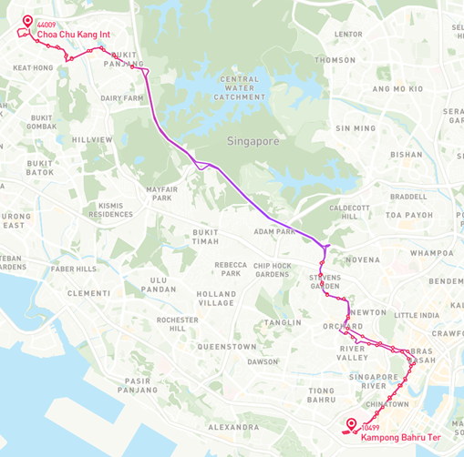

*Originally published on Medium as "[Singapore's Most Crowded Bus Routes: A deep dive into public bus data (Part 2)](https://medium.com/@simpletan/singapores-most-crowded-bus-routes-a-deep-dive-into-public-bus-data-part-2-a1cd6686b53e)" on 14 June 2025. This is Part 2; [Part 1](/posts/2025-04-01_busiest-bus-trips/) looks at the busiest stop-to-stop trips.*

::: tldr
[TL;DR]{.tldr-title}

- Leaving out the Causeway services (160, 170 and 950), service 35 (Bedok Int to Alps Ave loop) has the highest all-day average load: 46.3 passengers per bus on weekends and public holidays. On weekdays, 969 and 161 lead at 33.2.
- Most of the all-day top 10 run long expressway or non-stop stretches, especially along the TPE–SLE corridor between Woodlands and Tampines (969, 161, 168, 118).
- Peaks are much higher than all-day averages. Service 35 reaches 84.2 in the AM peak on weekends and public holidays. On weekdays, 118 hits 53.4 in the AM peak, while 969 (57.0) and the NTU loop 179 (52.3) top the PM peak.
- Tampines feeders 291 and 293 are the only feeders in the all-day top 10 (about 29 passengers per bus). In the AM non-peak, buses are generally fuller on weekends than on weekdays.
- Service 190 tops the PM non-peak, from Kampong Bahru to Choa Chu Kang (34.4 on weekdays, 32.2 on weekends).
- City Direct and Express buses reach 40–50 passengers in the weekday AM peak (657, 868E, 674, 663), but regular Express routes otherwise don't show high loads.
:::

This is a continuation of the [article that I wrote](/posts/2025-04-01_busiest-bus-trips/) about the analysis of Singapore's public bus passenger data. In that article, I had mentioned that I would have liked to estimate the passenger load levels on the different route segments. Comments on the [Reddit thread](https://www.reddit.com/r/singapore/comments/1jrd1ve/a_deep_dive_into_singapores_public_bus_systems/) that I posted in r/singapore seemed to be receptive to the idea of a follow-up article too.

Well, here we are! On top of estimating the passenger loads on the route segments, I will also be expanding on that to estimate and visualize the passenger loads on entire bus routes, at different times of the day.

## Objective

The main objective of this exercise remains largely unchanged from the previous article's intent, and that is to identify the most popular and utilized route segments of the public bus system. On top of that, I would also like to be able to identify the bus routes with the highest passenger loads, and perhaps see which services are truly in high demand.

## Methodology {#method}

As with the previous article, the analysis uses data from [LTA DataMall](https://datamall.lta.gov.sg/content/datamall/en.html). The key dataset comprises Passenger Volume from Origin to Destination (PV-OD), detailing the number of trips between all available bus stop pairs. The analysis is based on the PV-OD data from **March 2025**. In addition, to help visualize the bus routes, screenshots were all obtained courtesy of [busrouter.sg](https://busrouter.sg/).

To estimate passenger load on each bus segment, we need to do more than just look at raw PV-OD numbers. We need a way to distribute those numbers over time and relate them to the actual bus capacity serving the segments. This involves several steps:

1.  **Mapping bus stop pairs to routes and directions.** First, the PV-OD data must be mapped to actual bus routes, matching each origin–destination pair to specific route segments of bus services, including the direction of travel. This is done by finding the overlaps in services calling at bus stop pairs, and then mapping the direction of travel with the bus route database.
2.  **Estimating passenger volume over time.** From the PV-OD data, we can calculate the average number of passengers per hour.
3.  **Estimating the number of buses in operation in the route segment.** To assess load per vehicle, we need an estimate of how many buses are running during a given period. This involves:
    - Determining the number of services operating on each route. This number includes short-trip variants, which are considered as separate services.
    - Using published bus frequencies and operating hours from LTA DataMall's dataset to estimate how many buses pass through each segment in an hour. Bus frequencies are reported in terms of time blocks (AM peak and non-peak, PM peak and non-peak) for the entire route. On the other hand, operating hours for each service are reported for each bus stop along the route.

With these inputs, we calculate:

> Passengers per bus per hour = Passengers per hour / Number of buses

This formula gives a proxy for passenger load per bus, allowing us to highlight congested segments and time windows. From these computations, we can get an overall mean passenger loading of all bus services, across different times and portions of the route.

The mean loadings are also computed for each of the following time blocks, following the definitions in the LTA DataMall documentation:

- AM peak: 6.30am to 8.30am
- AM non-peak: 8.31am to 4.59pm
- PM peak: 5pm to 7pm
- PM non-peak: after 7pm

The passenger loads per bus for each service are computed and differentiated between weekdays and weekends/public holidays, and for each direction of travel, if it is a bi-directional service.

For now, we exclude the buses that cross the Causeway (i.e. 160, 170 and 950) since they are in a league of their own, almost completely sweeping up the top spots in passenger loading, regardless of time period.

Another point to make is that there are two ways to view the passenger load along the route of a service: either the distance along the route, or the number of stops along the route. For this article, I use the distance method as I think it best reflects the passenger experience on the bus journey. Some longer distance routes might have fewer bus stops than, say, feeder bus routes, but the distance between certain stops could be far apart, especially for express buses or buses that ply on expressways for a significant portion of the route. By just looking at the number of stops, the assumption is that the bus stops are equidistant from each other, which is not always the case.

## Challenges and assumptions

A direct method, such as pulling live bus crowdedness data from the LTA Bus Arrival API, is unfortunately impractical. The API only provides qualitative indicators like "seats available", "standing room only" or "limited standing", something similar to the traffic light rating system of green, yellow and red. Moreover, the data is dynamic and would require long-term monitoring for statistical significance.

Instead, we rely on aggregate PV-OD data, which allows for broader trend analysis over time. This approach makes several assumptions:

- the PV-OD data is representative of typical usage patterns;
- bus frequency and schedule data are relatively consistent;
- passenger distribution is even across all different bus services operating a route during a given hour.

Hence, these estimates of bus loading are not "accurate" but should still be sufficient in providing a sense of the bus loading for each service.

In addition, some of the PV-OD data also seems to be weird, in the sense that there are no buses that seem to fit the bus stop pair, but then there are non-zero passenger trips for this data point.

There are also some PV-OD data points that have non-zero passenger trips, and in theory have connecting buses, but due to the operating hours of the services are deemed to not have any buses in operation in that route segment.

No buses but there's passengers? Wait a minute…

](knight-bus.jpeg){fig-alt="The purple triple-decker Knight Bus from Harry Potter speeding down a street at night."}

Actually, a plausible explanation is that bus services are extended on specific days such as eves of public holidays, especially feeder buses from interchanges, which is not reported in DataMall's static dataset. Another explanation would be sporadic events that cause route diversions or detours, due to traffic conditions, road closures, or even major events. Unfortunately, these events aren't listed in the dataset, and would have to be pulled manually from the bus operators' or LTA's website directly.

](new-years-eve-extended-hours.jpg){fig-alt="Tower Transit poster announcing extended last-bus times on the Eve of New Year's Day 2024 for services from Clementi, Jurong East, Bukit Batok and Sembawang interchanges."}

Nevertheless, these non-standard PV-OD data points usually have fewer than 10 trips, so in theory the impact on this first-cut level of analysis should be quite limited. I'll probably go deeper into this (and include it in my data cleaning process) and also talk about peculiarities of the datasets in a future article.

Last but not least, another limitation is that the analysis is based on the PV-OD data from March 2025 rather than the latest month available. I will try to use the latest datasets in future pieces!

## The most crowded services overall

On to the results! Let's first look at the top 10 bus services in terms of their mean passenger load throughout the day.

| Service | Avg load | Type | Direction | Start | End / loop | Day type |
|:----------|----------:|:----------|:----------|:----------|:----------|:----------|
| 35 | 46.3 | Trunk | Loop | Bedok Int | Alps Ave | Weekends / Holiday |
| 969 | 33.2 | Trunk | 2 | Tampines Int | Woodlands Int | Weekday |
| 161 | 33.2 | Trunk | 2 | Woodlands Int | Hougang Ctrl Int | Weekday |
| 168 | 32.0 | Trunk | 2 | Woodlands Int | Bedok Int | Weekday |
| 168 | 31.2 | Trunk | 1 | Bedok Int | Woodlands Int | Weekday |
| 969 | 30.9 | Trunk | 1 | Woodlands Int | Tampines Int | Weekday |
| 161 | 29.7 | Trunk | 1 | Hougang Ctrl Int | Woodlands Int | Weekday |
| 118 | 29.4 | Trunk | 1 | Punggol Temp Int | Changi Business Pk Ter | Weekday |
| 293 | 29.3 | Feeder | 1 | Tampines Int | Tampines St 71 | Weekday |
| 291 | 29.0 | Feeder | 1 | Tampines Int | Tampines St 81 | Weekday |

: Top 10 bus services by mean passenger load per bus across the whole day (March 2025)

Again, to highlight, the average load here means the average number of passengers you would *expect* to see when you board the bus during its operating hours, *regardless* of time of the day, or which bus stop you get on. Of course, as with any statistical value, there are variations and fluctuations in time and in space as well, which we will explore later and also perhaps in the next article!

Also, you could visualize passenger loading with respect to the actual maximum capacity of the bus, be it bendy, single or double-decked bus. I didn't put the passenger load as percentage of bus occupied, since we don't have the detail of information regarding the types of buses being deployed at a specific time. There is after all a big difference between the passenger capacity of a single-decked bus (about 90 pax), double-decked bus (about 130 pax), and the rarer articulated bendy bus (about 150 pax). In my opinion, having more than **50 passengers** on board, regardless of bus type, would constitute as being "crowded" in most people's perception.

Back to the table: most of the buses that made this list have long segments of their routes on expressways, or have long non-stop sectors. It is also no coincidence that most of these services go through the heavily utilized Tampines Expressway (TPE) and Seletar Expressway (SLE) corridor, between Woodlands and Tampines.

Why is that so? Both Woodlands and Tampines are near large industrial estates: Senoko/Woodlands Industrial Parks and Changi Business Park respectively. Polytechnics such as Republic and Temasek Polytechnics are also situated right at these estates. Not only that, Punggol and Sengkang sit right in the middle of the SLE–TPE corridor, which provides the demand for transportation to both Woodlands and Tampines for both work and school, creating a dense and bi-directional flow of passengers for routes such as 969 and 168.

{fig-alt="Map of north-east Singapore showing services 161, 168, 969 and 118 running along the SLE and TPE expressway corridor between Woodlands, Punggol, Hougang and Tampines."}

There are a couple of entries that seem to deviate from the norm:

1.  For service 35, the top mean passenger loading occurs not during the weekdays, but during weekends instead. This is interesting because while this route exclusively covers industrial areas like Airport Logistics Park (ALPS) and Changi Naval Base, it seems like the weekend demand comes from presumably passengers heading to Tanah Merah Ferry Terminal, which operates ferry services to popular tourist destinations like Batam and Bintan. This weekend crowd outweighs the working crowd on weekdays. Also note that 35 only operates for limited hours on Saturdays, 6 am to 3 pm, and not on Sundays and public holidays, so that helps us to narrow down the times where the passenger demand is consistently high. The high passenger load could also be a result of the relatively slower bus frequencies (15 min) during the weekend.

    {fig-alt="Map of the eastern tip of Singapore showing service 35 looping around Changi Airport via Tanah Merah, Changi Bay and the coastal road."}

2.  Buses 293 and 291 are the only feeder buses that made this list, and what's more interesting is that both are actually feeder buses that operate in two loops (East and West loops) within Tampines, which as we know is one of the larger and sprawling estates in Singapore, consisting of both industrial and residential areas. Having such a high average passenger load throughout tells us about the residents' reliance on these routes to bring them from the fringes of the estate to and from the interchange and MRT stations.

    {fig-alt="Map of Tampines showing the looping routes of feeder services 291 and 293 radiating from Tampines Interchange."}

## The most crowded services by time of day

Moving on, let's look at the passenger loading with more granularity, dividing up the time periods into the following time blocks: AM peak, PM peak, AM non-peak and PM non-peak. For each time block, we will look at the top 10 most crowded services.

### AM peak {#am-peak}

| Service | Avg load | Type | Direction | Start | End / loop | Day type |
|:----------|----------:|:----------|:----------|:----------|:----------|:----------|
| 35 | 84.2 | Trunk | Loop | Bedok Int | Alps Ave | Weekends / Holiday |
| 118 | 53.4 | Trunk | 1 | Punggol Temp Int | Changi Business Pk Ter | Weekday |
| 657 | 50.4 | City Direct | 1 | Jurong West Ave 1 | Marina Bay Financial Ctr | Weekday |
| 868E | 49.3 | Express | 1 | Bt Batok West Ave 5 | Aft Promenade Stn Exit C | Weekday |
| 969 | 46.2 | Trunk | 1 | Woodlands Int | Tampines Int | Weekday |
| 161 | 46.0 | Trunk | 1 | Hougang Ctrl Int | Woodlands Int | Weekday |
| 118A | 45.3 | Trunk | 1 | Punggol Temp Int | ITE Coll East Adm Blk | Weekday |
| 674 | 45.3 | City Direct | 1 | Tengah Drive | Marina Bay Financial Ctr | Weekday |
| 663 | 44.7 | City Direct | 1 | Bet Blks 405/406 | Opp MAS Bldg | Weekday |
| 972A | 42.0 | Trunk | 1 | Bt Panjang Int | Dhoby Ghaut Stn | Weekday |

: Top 10 bus services by mean passenger load per bus in the AM peak (6.30am to 8.30am)

From this, we can see that services like 118, 969 and 161 show much higher average loads during the AM peak than their all-day averages. This implies these routes experience concentrated peak usage, mainly due to work or school.

Service 35 tops the AM peak table with a significant margin over the rest of the services (80+ for bus 35 vs 40–50 for the rest), but for weekends and public holidays only. This could mean that there are even more passengers heading to the ferry terminal, or weekend industrial workers that could be heading to or from ALPS, due to the nature of airport logistics work.

We also see the City Direct and Express buses start to appear in the ranks during AM peak periods. For those who are unaware, City Direct buses are express bus services that operate between residential estates and the Central Business District (CBD) during weekday peak hours only. Both City Direct and Express services charge higher fares than regular trunk or feeder services.

](city-direct-simplygo.jpeg){fig-alt="SimplyGo promotional graphic for City Direct buses, headlined 'No More Long Detours!', showing a route from Punggol, Sengkang and Hougang to Tanjong Pagar, Bayfront and Promenade."}

Their relatively high average loads (40–50 passengers) show strong demand from residential estates like Jurong West, Bukit Batok and Tengah, where there are no direct MRT or even regular bus routes to the CBD area. This could mean that commuters value faster, more direct and convenient journeys, and that they are more willing to pay higher fares for comfort and time savings.

We'll have a small [separate section](#bonus-city-direct-buses-in-the-am-peak) looking at the passenger loads of the City Direct services as well.

### PM peak

| Service | Avg load | Type | Direction | Start | End / loop | Day type |
|:----------|----------:|:----------|:----------|:----------|:----------|:----------|
| 969 | 57.0 | Trunk | 2 | Tampines Int | Woodlands Int | Weekday |
| 179 | 52.3 | Trunk | Loop | Boon Lay Int | Nanyang Dr | Weekday |
| 168 | 51.3 | Trunk | 1 | Bedok Int | Woodlands Int | Weekday |
| 969A | 49.4 | Trunk | 1 | Tampines Int | Yishun Stn | Weekday |
| 114 | 47.8 | Trunk | Loop | Buangkok Int | Buangkok Cres | Weekday |
| 969 | 47.7 | Trunk | 1 | Woodlands Int | Tampines Int | Weekday |
| 118 | 46.4 | Trunk | 2 | Changi Business Pk Ter | Punggol Temp Int | Weekday |
| 241 | 44.2 | Feeder | Loop | Boon Lay Int | Jurong West St 91 | Weekday |
| 858 | 44.1 | Trunk | Loop | Woodlands Int | Changi Airport PTB2 | Weekday |
| 87 | 42.9 | Trunk | 2 | Bedok Int | Sengkang Int | Weekday |

: Top 10 bus services by mean passenger load per bus in the PM peak (5pm to 7pm)

The top 10 most crowded services in the PM peak period also have some overlap with the AM peak period, namely 969, 168 and 118. 858 did not appear in the AM peak period but shows up here, and similarly also has a large express portion in the TPE–SLE corridor. The similar patterns could be because the working crowd who went to work in the morning are heading back to their homes in the evening with the same bus services.

A notable inclusion would be 179, making it the second most crowded bus service in the PM peak. This could be attributed to the high demand from students at Nanyang Technological University heading to either Pioneer or Boon Lay MRT stations after school. It looks to be way more crowded and used than its fellow NTU service 199, likely due to two reasons: the fact that it offers a faster connection to the MRT at Pioneer station, and it serves more academic buildings in NTU than 199, which primarily stops at residential halls and the NIE buildings. All this is speculation of course. Maybe NTU students can chime in if this is true, and confirm if 179 is indeed really as crowded as the data suggests!

### AM non-peak

| Service | Avg load | Type | Direction | Start | End / loop | Day type |
|:----------|----------:|:----------|:----------|:----------|:----------|:----------|
| 35 | 71.5 | Trunk | Loop | Bedok Int | Alps Ave | Weekends / Holiday |
| 35M | 37.0 | Trunk | Loop | Bedok Int | Tanah Merah Ferry Rd | Weekends / Holiday |
| 291 | 35.7 | Feeder | 1 | Tampines Int | Tampines St 81 | Weekends / Holiday |
| 161 | 34.3 | Trunk | 2 | Woodlands Int | Hougang Ctrl Int | Weekends / Holiday |
| 293 | 34.2 | Feeder | 1 | Tampines Int | Tampines St 71 | Weekends / Holiday |
| 161 | 34.1 | Trunk | 1 | Hougang Ctrl Int | Woodlands Int | Weekends / Holiday |
| 190 | 33.7 | Trunk | 1 | Choa Chu Kang Int | Kampong Bahru Ter | Weekends / Holiday |
| 859 | 32.2 | Trunk | Loop | Sembawang Int | Yishun Int | Weekends / Holiday |
| 293 | 31.8 | Feeder | 1 | Tampines Int | Tampines St 71 | Weekday |
| 147 | 31.6 | Trunk | 1 | Hougang Ctrl Int | Clementi Int | Weekends / Holiday |

: Top 10 bus services by mean passenger load per bus in the AM non-peak (8.31am to 4.59pm)

In the AM non-peak, 35 and 35M still have high ridership that surpasses their daily averages for weekends and public holidays. This still indicates significant demand from workers, which could be the case due to irregular work hours or shift work in the industries at ALPS.

For 291 and 293, the fact that they have such high passenger loads in the mornings, especially on weekends, likely highlights their importance within Tampines for non-work purposes, such as bringing the residents to the Tampines town centre and MRT stations for leisure activities.

It is also interesting to note that buses are more packed during weekends and public holidays, as compared to weekdays for AM non-peak hours, likely due to more people taking the buses for leisure on non-working days. This could also mean that buses are quite empty during AM non-peak hours on weekdays.

### PM non-peak

| Service | Avg load | Type | Direction | Start | End / loop | Day type |
|:----------|----------:|:----------|:----------|:----------|:----------|:----------|
| 190 | 34.4 | Trunk | 2 | Kampong Bahru Ter | Choa Chu Kang Int | Weekday |
| 190 | 32.2 | Trunk | 2 | Kampong Bahru Ter | Choa Chu Kang Int | Weekends / Holiday |
| 168 | 31.1 | Trunk | 1 | Bedok Int | Woodlands Int | Weekends / Holiday |
| 291 | 30.0 | Feeder | 1 | Tampines Int | Tampines Int | Weekends / Holiday |
| 168 | 30.0 | Trunk | 1 | Bedok Int | Woodlands Int | Weekday |
| 293 | 29.4 | Feeder | 1 | Tampines Int | Tampines Int | Weekday |
| 291 | 29.1 | Feeder | 1 | Tampines Int | Tampines Int | Weekday |
| 293 | 28.5 | Feeder | 1 | Tampines Int | Tampines Int | Weekends / Holiday |
| 161 | 27.5 | Trunk | 2 | Woodlands Int | Hougang Ctrl Int | Weekends / Holiday |
| 34 | 26.6 | Trunk | 1 | Punggol Temp Int | Changi Airport PTB2 | Weekends / Holiday |

: Top 10 bus services by mean passenger load per bus in the PM non-peak (after 7pm)

Now finally, the legendary bus 190 has made it to the top of the list. It is known to be a very popular route, and an extremely crowded one as well, due to bus bunching and likely insufficient frequencies of buses. This [YouTube video](https://www.youtube.com/watch?v=ezQlayJE8Qs) from the year 2013 pretty much sums up all that is to say about it.

[{fig-alt="Still from the YouTube video 'Bus 190: Mission Impossible', showing a woman trying to board a packed bus 190 through its rear door at night."}](https://www.youtube.com/watch?v=ezQlayJE8Qs)

Back in the day, without the Downtown MRT line, 190 was pretty much the main way to get from Choa Chu Kang and Bukit Panjang to Orchard and downtown areas due to the long express route segment via Bukit Timah Expressway (BKE) and Pan-Island Expressway (PIE), cutting through the centre of Singapore and providing the most direct route. At some point it was probably the most used bus route. Today, with the Downtown Line, as well as other alternative routes such as 972, it is significantly less crowded, but we can see that it is still the most preferred route on PM non-peak, from town to Choa Chu Kang. This could be because the passengers are aware that the expressways at night are less congested, and so the bus ride is likely more convenient and direct than transferring between MRT and feeder buses.

{fig-alt="Map of service 190's route from Choa Chu Kang Interchange through Bukit Panjang, along the BKE and PIE past the Central Water Catchment, then through Orchard to Kampong Bahru Terminal."}

## Bonus: City Direct buses in the AM peak {#bonus-city-direct-buses-in-the-am-peak}

Here is the passenger load data for City Direct buses as I mentioned earlier in this article, and also requested by [u/A_extra](https://www.reddit.com/r/singapore/comments/1jrd1ve/comment/mldvmox/) in the Reddit thread for the previous article.

| Rank | Service | Start             | End                       |
|-----:|:--------|:------------------|:--------------------------|
|    1 | 657     | Jurong West Ave 1 | Marina Bay Financial Ctr  |
|    2 | 674     | Tengah Drive      | Marina Bay Financial Ctr  |
|    3 | 663     | Yishun Ave 6      | Opp MAS Bldg              |
|    4 | 651     | Jurong West Ave 3 | Marina Bay Financial Ctr  |
|    5 | 656     | Canberra Rd       | Opp MAS Bldg              |
|    6 | 671     | Punggol Rd        | Promenade Stn/Pan Pacific |
|    7 | 670     | Yishun Ave 7      | Marina Bay Financial Ctr  |
|    8 | 655     | West Coast Rd     | Marina Bay Financial Ctr  |
|    9 | 652     | Upp Thomson Rd    | Opp MAS Bldg              |
|   10 | 660M    | Buangkok Cres     | Opp MAS Bldg              |

: Top 10 City Direct services by mean passenger load per bus, weekday AM peak, towards the CBD

::: callout-note
## Correction

The load figures in the first version of this table were copied by mistake from the PM non-peak table, so they have been removed until they can be recomputed. The three services that also appear in the [AM peak table](#am-peak) carry 50.4 (657), 45.3 (674) and 44.7 (663) passengers per bus.
:::

Again, to recap, City Direct buses are express buses that operate between residential estates and the Central Business District (CBD) via expressways, with limited buses (usually 2 or 3) on weekday peak periods only. Currently, there are 24 City Direct services in operation.

Even though City Direct services also operate in the PM peak in the opposite direction (i.e. CBD to residential estates), I chose to zoom in on AM peak in particular since it appears that the demand from passengers from home to work is much more than the journey from work to home, likely because most people don't head home directly after work at a specific time (overtime, errands to run, leisure activities after work etc).

From the table, we can tell that City Direct services during AM peak seem to be well utilized in towns far from the CBD, particularly in Jurong, Tengah and Yishun, where MRT travel to town is long, crowded or requires multiple transfers between buses and trains. These towns tend to be in the northern and western parts of Singapore, with some representation from Punggol and Buangkok.

Only the top few City Direct services are as crowded as the popular trunk services in the AM peak, which makes sense as not everybody works in the CBD. It could also be that the bus stops in the residential estates and operation times may not be super optimized to capture higher passenger demand.

## Final thoughts

In general, any type of bus route that covers a large portion of expressways or non-stop segments is in high demand, especially if these portions of the routes don't have an alternative MRT line. That should come as no surprise.

What's odd is that the actual Express routes (services that have -E or -e suffixes, 502, 506 and 518) don't appear to have high passenger loads. Perhaps the low frequency and limited operating hours for most of them don't make them very compelling options to ride, as compared to taking the MRT.

It also makes me wonder if more Express routes could be introduced as a way to connect MRT stations of different lines, especially between stations that are far away from interchange stations. That may be a hidden gap in demand that is not yet addressed.

Also, it seems like there is potential for City Direct services to not necessarily serve the CBD area (Non-City Direct?), but other decentralized industrial and office centres, such as Jurong East, one-north, Buona Vista and Kent Ridge. We can have a better insight into this once we look at MRT passenger data. Perhaps inter-town express buses that cover a long distance (e.g. Tampines to Jurong East) can also have potential for high demand.

## What's next

Since I already have the passenger loading data for all the services as a function of the stops along the route, I could visualize the data through graphs and animations, to better illustrate the patterns of bus crowdedness across segments of the routes, and times of the day. This will likely be done for a select number of routes which are known to be really heavily used.

Looking ahead, perhaps I could also incorporate MRT train passenger data into the analysis as well, giving a more holistic treatment of the bus data in the context of the entire public transport network.

I also mentioned that I'll do up an article regarding interesting trivia that I come across in my data deep dive, but I'll probably KIV that until the heavy lifting of data analysis and visualization is done.

If there are any ideas on what I can look into regarding bus passenger data, let me know!

That's all I have, till next time!