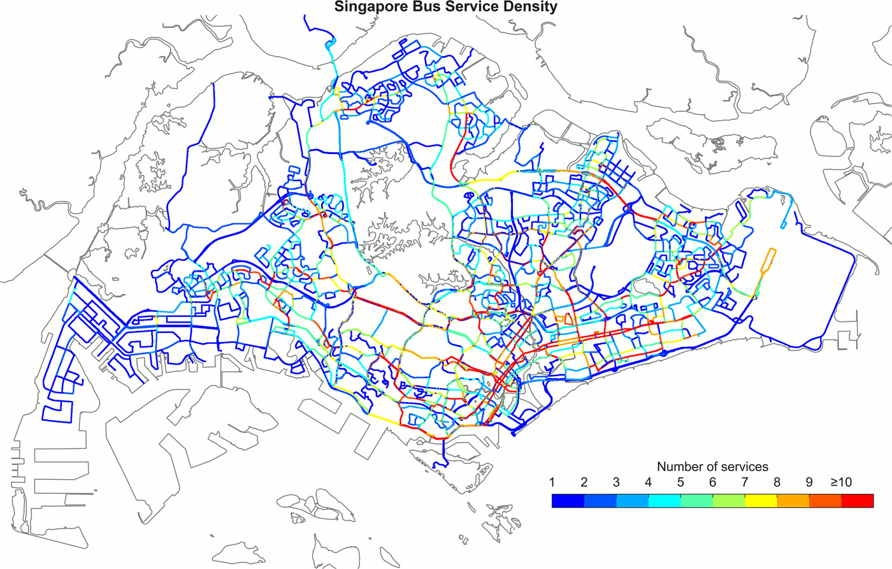
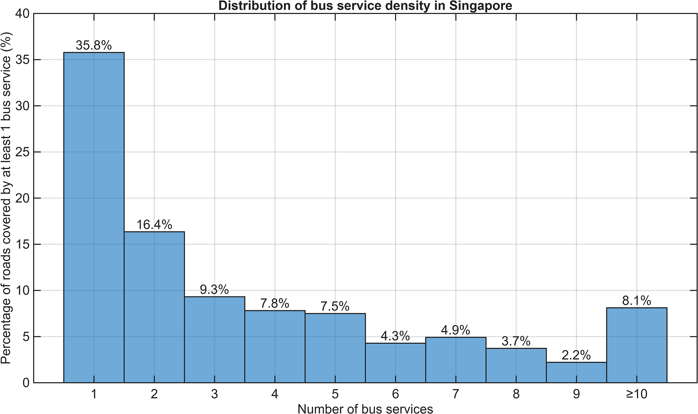

*Originally published on Medium as "[A density map of Singapore's bus services, imagined as a circulatory system](https://medium.com/@simpletan/a-density-map-of-singapores-bus-services-imagined-as-a-circulatory-system-07a24001a8db)" on 2 March 2026 as a static image. This version is interactive.*

::: {.tldr}
[TL;DR]{.tldr-title}

- Picture the bus network as a circulatory system. The red roads are the arteries: the CBD, Civic District and Downtown, plus arterial roads like Bukit Timah Road, Sims Avenue and Orchard Road.
- The blue and green roads are the capillaries. They carry the last-mile trips through housing estates and industrial areas.
- Roads with three or fewer bus services make up more than half of the bus network.
- Older estates (Toa Payoh, Ang Mo Kio, Bedok) have curvy, irregular roads. Newer ones (Punggol, Tengah) are laid out in grids.
:::

Tap or click any road to see how many bus services run along it, and which ones. Use the slider to hide quieter roads.

```{=html}
<div class="map-controls">
  <label for="min-svc">Show roads with at least <strong id="min-svc-val">1</strong> service<span id="min-svc-plural"></span></label>
  <input type="range" id="min-svc" min="1" max="10" step="1" value="1">
</div>
<div id="density-map" class="map-frame" role="region" aria-label="Interactive map of bus service density in Singapore"></div>
<div class="map-legend" aria-hidden="true">
  <span>Number of services</span>
  <div class="map-legend-bar" id="map-legend-bar"></div>
  <div class="map-legend-labels"><span>1</span><span>2</span><span>3</span><span>4</span><span>5</span><span>6</span><span>7</span><span>8</span><span>9</span><span>10+</span></div>
</div>
<noscript><p></p></noscript>
<link rel="stylesheet" href="https://cdnjs.cloudflare.com/ajax/libs/leaflet/1.9.4/leaflet.min.css">
<script src="https://cdnjs.cloudflare.com/ajax/libs/leaflet/1.9.4/leaflet.min.js"></script>
<script>
(function () {
  // Colours for 1..10+ services, blue (few) to red (many), as in the original map.
  var COLORS = ["#2b3bd6", "#2f6fe0", "#2aa0e6", "#22c3d6", "#3bd18f",
                "#9ad13a", "#e8d21d", "#f7a21b", "#f2641c", "#d7191c"];
  document.getElementById("map-legend-bar").style.background =
    "linear-gradient(to right," + COLORS.map(function (c, i) {
      return c + " " + (i * 10) + "%," + c + " " + ((i + 1) * 10) + "%";
    }).join(",") + ")";

  var dark = document.body.classList.contains("quarto-dark");
  var sg = L.latLngBounds([1.144, 103.535], [1.494, 104.1]);
  var map = L.map("density-map", { preferCanvas: true, zoomSnap: 0.5, minZoom: 11, maxZoom: 19,
                                   maxBounds: sg.pad(0.1) })
    .setView([1.355, 103.82], 11);
  window.densityMap = map;
  function tileUrl(isDark) { return "https://www.onemap.gov.sg/maps/tiles/" + (isDark ? "Night" : "Grey") + "/{z}/{x}/{y}.png"; }
  var tiles = L.tileLayer(tileUrl(dark), {
    attribution: 'Base map: <a href="https://www.onemap.gov.sg/">OneMap</a> &copy; <a href="https://www.sla.gov.sg/">Singapore Land Authority</a> · Routes: <a href="https://busrouter.sg/">BusRouter SG</a>',
    minZoom: 11, maxZoom: 19, bounds: sg
  }).addTo(map);
  // Switch the base map when the reader toggles light/dark mode.
  new MutationObserver(function () {
    var isDark = document.body.classList.contains("quarto-dark");
    if (isDark !== dark) { dark = isDark; tiles.setUrl(tileUrl(dark)); }
  }).observe(document.body, { attributes: true, attributeFilter: ["class"] });
  var renderer = L.canvas({ tolerance: 6 });
  var layers = [];   // one layer group per bucket (index 0 = 1 service)
  for (var b = 0; b < 10; b++) layers.push(L.layerGroup().addTo(map));

  function weight() { var z = map.getZoom(); return z < 12 ? 1.6 : z < 14 ? 2.4 : z < 16 ? 3.5 : 5; }

  fetch("data/density.json").then(function (r) { return r.json(); }).then(function (d) {
    // Add quieter roads first so busier roads are drawn on top.
    d.lines.sort(function (a, b) { return a[0] - b[0]; });
    d.lines.forEach(function (line) {
      var bucket = line[0], setId = line[1], flat = line[2], pts = [], la = 0, lo = 0;
      for (var i = 0; i < flat.length; i += 2) { la += flat[i]; lo += flat[i + 1]; pts.push([la / 1e5, lo / 1e5]); }
      var pl = L.polyline(pts, { color: COLORS[bucket - 1], weight: weight(), opacity: 0.9, renderer: renderer });
      pl.on("click", function (e) {
        var svcs = d.sets[setId].map(function (k) { return d.services[k]; });
        L.popup({ maxWidth: 260 }).setLatLng(e.latlng).setContent(
          "<strong>" + svcs.length + " bus service" + (svcs.length === 1 ? "" : "s") + "</strong><br>" +
          '<span class="map-svcs">' + svcs.join(", ") + "</span>").openOn(map);
      });
      layers[bucket - 1].addLayer(pl);
    });
  }).catch(function () {
    document.getElementById("density-map").innerHTML = '<p style="padding:1rem">The map data could not be loaded. <a href="static-density-map.jpg">View the static map instead.</a></p>';
  });

  map.on("zoomend", function () {
    var w = weight();
    layers.forEach(function (g) { g.eachLayer(function (l) { l.setStyle({ weight: w }); }); });
  });

  var slider = document.getElementById("min-svc");
  slider.addEventListener("input", function () {
    var min = +slider.value;
    document.getElementById("min-svc-val").textContent = min === 10 ? "10" : min;
    document.getElementById("min-svc-plural").textContent = min === 1 ? "" : "s";
    layers.forEach(function (g, i) {
      if (i + 1 >= min) { if (!map.hasLayer(g)) map.addLayer(g); } else map.removeLayer(g);
    });
  });
})();
</script>
```

.](static-density-map.jpg){fig-alt="Static map of Singapore's roads coloured from blue (1 bus service) to red (10 or more services)."}

This map shows the density of public bus services in Singapore. These only include routes that have normal operating hours, which are the Trunk and Feeder services, as well as full-day Express and Short-trip routes.

What's interesting is that you can imagine this map as a circulatory system, with the clusters of orange and red segments being like the main arteries of the system. This shows the high demand for buses in the central region at the CBD, Civic District and Downtown areas, as well as the various bus/MRT interchanges in heartland areas scattered across the northern, western and eastern regions of Singapore. More often than not, the number of buses that operate on a road also somewhat reflects how busy that road is in terms of car usage and density (with the exception of expressways). In the map, you can also see long stretches of red roads, such as Bukit Timah Road, Sims Avenue and Orchard Road. These roads are aptly called [arterial roads](https://www.lta.gov.sg/content/dam/ltagov/getting_around/driving_in_singapore/pdf/list_of_major_arterial_road_corridors_with_emas_r2.pdf).

Likewise, the blue and green roads can be imagined as the capillaries of the bus circulatory system, serving regions that are outside of the transport hubs, such as residential estates and industrial regions. We can see that roads which have up to three bus routes servicing them form more than 50% of the entire bus system coverage, as seen from the distribution below. These are the areas where the bus services serve the important last-mile journeys.

| Bus services on the road | Share of bus-served road length |
|:--|--:|
| 1 | 24.2% |
| 2 | 17.5% |
| 3 | 10.4% |
| 4 | 8.5% |
| 5 | 6.9% |
| 6 | 6.1% |
| 7 | 4.4% |
| 8 | 4.4% |
| 9 | 3.7% |
| 10 or more | 13.8% |

: Interactive map: share of the 1,728 km of bus-served road (each direction of a dual carriageway counted separately) by number of bus services.

{fig-alt="Bar chart of the share of bus-served roads by number of bus services in the static map: 1 service 35.8%, 2 services 16.4%, 3 services 9.3%, 4 services 7.8%, 5 services 7.5%, 6 services 4.3%, 7 services 4.9%, 8 services 3.7%, 9 services 2.2%, 10 or more 8.1%."}

One other interesting visual observation is that you can see how the roads are planned in the various estates. Older, more mature estates like Toa Payoh, Ang Mo Kio and Bedok have many curved, rounded roads that don't appear to have any pattern to them. The roads in newer estates like Punggol and Tengah are more rectangular, demonstrating a shift in urban planning design towards a more organised and simpler grid-like road network.

## Methodology {#method}

The bus route data were obtained from [BusRouter SG](https://github.com/cheeaun/busrouter-sg). Each bus route's trajectory is represented by a series of latitude-longitude pairs. These only include routes that have normal operating hours: 558 Trunk, Feeder, full-day Express and Short-trip services, with each variant (such as 14 and 14e) counted as its own service. City Direct, peak-hour-only express and seasonal services are excluded.

Each route is sampled every 5 metres, and nearby points from all routes are merged into shared road points about 12 metres apart, so services running along the same road line up exactly. Each stretch of road between two road points then keeps a count of the distinct bus services that pass through it, serving as the basis of the density map. Where a road has a central divider, its two directions are drawn as separate lines.

The static map was processed and plotted in MATLAB, with the routes interpolated to 1-metre spacing and allocated to a 5-metre grid, and overlaid on a polygon map of Singapore from [data.gov.sg](https://data.gov.sg/collections/1591/view). The interactive map uses the shared road points instead of a fixed grid, which avoids routes on the same road falling into slightly different grid cells. The [build script](build_density.py) for the interactive map is published with this post. The processing script for this interactive version was written with the help of Claude, and checked against the original static map.

## What's next?

I'd like to piggyback on the analysis that I had done for my previous two articles regarding [bus passenger volumes](/posts/2025-04-01_busiest-bus-trips/) and [crowdedness levels](/posts/2025-06-14_most-crowded-bus-routes/), and to integrate those data into this map. If that works out well, perhaps a time-lapse could be done, making the visualisation of Singapore's bus circulatory system more vivid and dynamic.

That's all for now!
