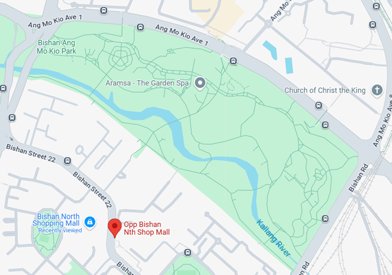
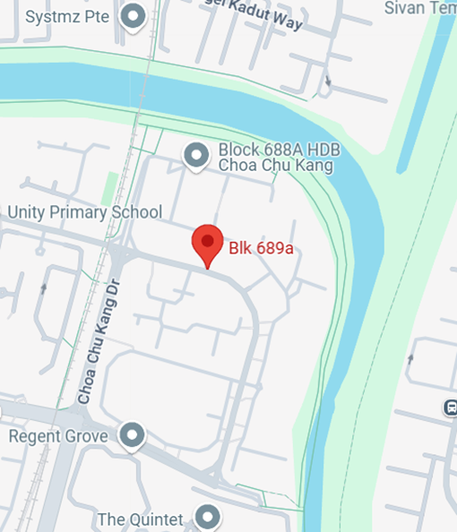
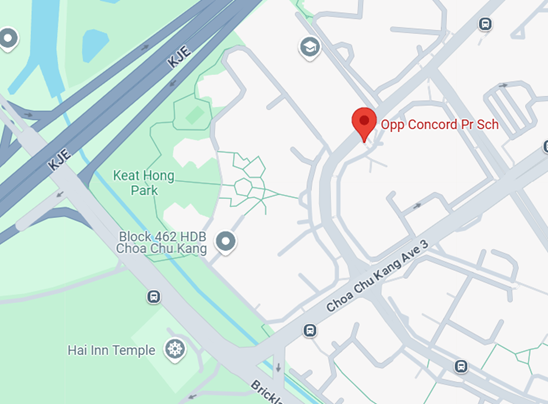
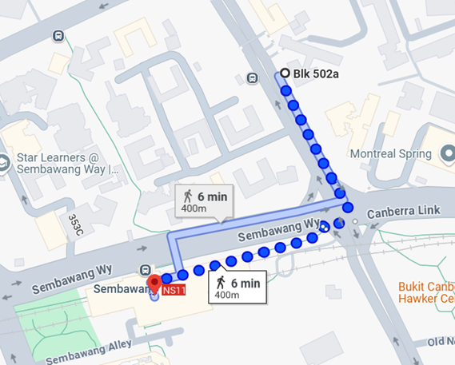
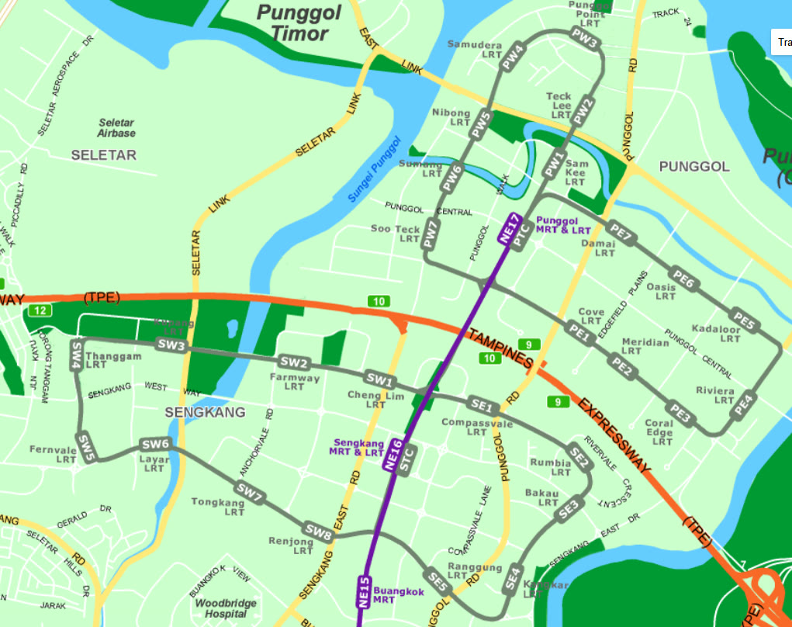
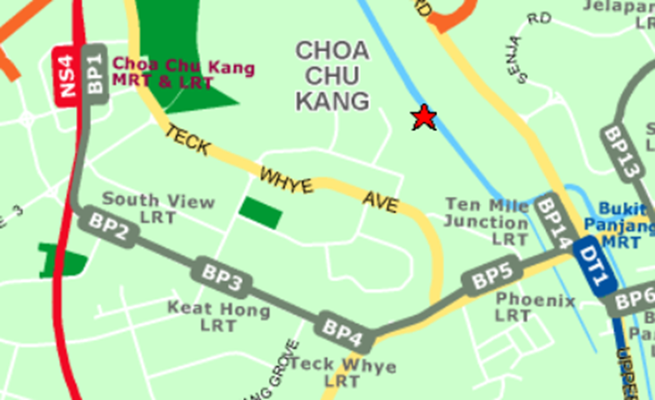

*Originally published on Medium as "[A deep dive into Singapore's public bus system's passenger volume data](https://medium.com/@simpletan/a-deep-dive-into-singapores-public-bus-system-s-passenger-volume-data-e0dd15ffa2c2)" on 1 April 2025.*

::: tldr
[TL;DR]{.tldr-title}

- Buses are crucial for cross-border movement, at least until the RTS is up. The busiest stop pair of all is Woodlands Checkpoint to Johor Bahru Checkpoint on weekend mornings, at about 1,700 mean trips per hour (services 160, 170, 950).
- Trips starting or ending at Woodlands or Tuas checkpoint are much lower: the top one is Woodlands Checkpoint to Kranji Station at 7am on weekdays, at about 1,024 trips per hour.
- Students (of all ages) are really dependent on buses to get to school. Yio Chu Kang Interchange to ITE College Central on service 72 hits about 916 trips per hour at 8am on weekdays.
- Buses are really important in estates with a low density of MRT or LRT connections, which are generally in the North and West of Singapore. Opp Bishan North Shopping Mall to Bishan Station (535 trips per hour) and several Choa Chu Kang and Boon Lay stop pairs top the MRT and interchange lists.
- Less so for workers, but buses are still important for industrial areas, such as Sembawang Shipyard and Jurong's industrial estate.
:::

*\[Update: Check out [part 2](/posts/most-crowded-bus-routes/) where I look at the crowdedness of bus services and route segments!\]*

## Objective

The objective of this exercise is to identify the most popular and utilised route segments of the public bus system, and to see if any interesting insights can be observed from the data.

## Methodology

All of the information was obtained from [LTA DataMall](https://datamall.lta.gov.sg/content/datamall/en.html). This includes the information about the bus services and the bus stops that each service covers, as well as the passenger volume (PV) from origin to destination (OD) in terms of number of trips, for each possible and available bus stop pair. The PV-OD data is tagged to the hour of the day, and also differentiated between weekdays and weekends.

More details regarding the data can be found in the [LTA DataMall documentation](https://datamall.lta.gov.sg/content/dam/datamall/datasets/LTA_DataMall_API_User_Guide.pdf).

Based on these sources of data, I was then able to obtain certain derived information, namely the following:

1.  Mean trips per hour — essentially taking the average of the PV-OD data based on the number of weekdays or weekends/public holidays
2.  Bus services that operate between each PV-OD bus stop pair
3.  Trip distance between the bus stop pair, i.e. the distance that is being driven by a bus service
4.  Straight line distance between the bus stop pair

Note about point 2 — the bus services which I tagged to the PV-OD pair were based on basic bus services, i.e. feeder, trunk and full-day express services. I considered short trip services, which have bus service suffixes A, B, and C, effectively similar to their parent services as they operate a subset of the original route. I also considered limited stop express services, which have suffixes e and E, in the same way as well.

On the other hand, route variants, which have suffixes M and X, are considered as separate routes since they generally cover a significant portion of the route differently from the parent service.

The above is just a simple heuristic to filter out the clutter that duplicate services make — some services can even have up to 3 variants, with different rules of operation. Looking at you, 975A, 975B and 975C.

## Limitations

The trips are registered only when passengers enter and exit a particular bus. It doesn't capture the start and end of a bus journey that involves more than one transfer between buses. So long as we are clear on this and do not attempt to make assumptions to link and join certain route segments, our analysis should still be valid.

## Results

All that is left is to sort the PV-OD (passenger volume, origin to destination) pairs by the mean number of trips by the hour period, by weekday or weekend/holiday. This will be done for February 2025.

After looking at the data, it became quite clear that the passenger volume could be categorised into a few main groups:

1.  JB-Woodlands checkpoint cross-border trips
2.  Start or end at Woodlands or Tuas checkpoint
3.  Start or end at schools — inclusive of JCs, Polytechnics and ITEs. Universities without their own internal shuttle buses were also included. Also, only trips in the morning peak period and early afternoon (up till 5pm) are considered under this category
4.  Start or end at MRT/LRT stations
5.  Start or end at bus interchanges/terminals
6.  Other bus stops that don't fall into any of the above categories

I will present and comment on the top 3 routes and hour of the day for each category.

### Category 1: JB-Woodlands checkpoint cross-border trips

| Day type | Hour | Mean trips/hr | Origin | Destination | Services |
|------------|-----------:|-----------:|------------|------------|------------|
| WEEKENDS/HOLIDAY | 9 | 1703.25 | W'Lands Checkpt | Johor Bahru Checkpt | 160, 170, 950 |
| WEEKENDS/HOLIDAY | 10 | 1700.5 | W'Lands Checkpt | Johor Bahru Checkpt | 160, 170, 950 |
| WEEKENDS/HOLIDAY | 8 | 1631.5 | W'Lands Checkpt | Johor Bahru Checkpt | 160, 170, 950 |

: Top 3 cross-border trips between Woodlands and JB checkpoints

I guess Singaporeans really love our weekend day trips to JB. I was also expecting to see high passenger volume for trips from JB to Woodlands, but the highest was 6th at 1540 mean trips per hour at 6am on weekdays, which to be fair is still a very high passenger volume contributed by the students and workers coming into Singapore daily.

Since the cross-border services use [various single-deck bus models](https://landtransportguru.net/new-bus-fleet-for-cross-border-public-buses/) that hold up to 91 passengers, that would mean at least 20 buses filled to the brim with passengers need to be operating within the hour, or an average of 3 mins per bus loading and offloading passengers.

*Edit: the initial version of the article stated that cross-border services were using the Scania K230UB, which is not the case since 2022.*

That's *a lot* of buses.

### Category 2: Start or end at Woodlands or Tuas checkpoint

| Day type | Hour | Mean trips/hr | Origin | Destination | Services |
|------------|-----------:|-----------:|------------|------------|------------|
| WEEKDAY | 7 | 1024.45 | W'Lands Checkpt | Kranji Stn | 160, 170 |
| WEEKDAY | 18 | 963.2 | Woodlands Int | W'Lands Train Checkpt | 911, 178, 912, 903, 856 |
| WEEKDAY | 6 | 926.5 | W'Lands Checkpt | Kranji Stn | 160, 170 |

: Top 3 trips starting or ending at Woodlands or Tuas checkpoint

You would think that, following the logic of the Woodlands to JB trip volume being so high on weekend mornings, trips ending at Woodlands checkpoint from elsewhere would be high too. However, the data shows otherwise, with the passenger volume also being significantly lower than the cross-border ones.

So how are people getting to Woodlands Checkpoint during weekend mornings, if not by bus? My guess is that many people either cab or take a PHV there, or perhaps they drive to the nearby HDB estates, which are within walking distance of the checkpoint.

### Category 3: Start or end at schools

| Day type | Hour | Mean trips/hr | Origin | Destination | Services | Straight-line dist. (m) |
|-----------|----------:|----------:|-----------|-----------|-----------|----------:|
| WEEKDAY | 8 | 915.6 | Yio Chu Kang Int | Ite Coll Ctrl | 72 | 1270 |
| WEEKDAY | 7 | 737.3 | Yio Chu Kang Int | Ite Coll Ctrl | 72 | 1270 |
| WEEKDAY | 16 | 691.45 | Opp Ite Coll Ctrl | Yio Chu Kang Int | 72 | 1253 |

: Top 3 trips starting or ending at schools

I was surprised to see the top 3 being dominated by commutes to and from ITE College Central, compared to the other ITE colleges which have similar student sizes. I was also expecting other types of schools in the top 3 as well. The closest is 6th at 574 mean trips per hour at 7am for Tan Kah Kee Station to Opp National JC — contributed by the density of schools in the area. Woodlands Interchange to Republic Polytechnic comes in at 7th with 552 mean trips per hour at 8am.

### Category 4: Start or end at MRT/LRT stations

| Day type | Hour | Mean trips/hr | Origin | Destination | Services | Straight-line dist. (m) |
|-----------|----------:|----------:|-----------|-----------|-----------|----------:|
| WEEKDAY | 8 | 535.3 | Opp Bishan Nth Shop Mall | BISHAN STN | 13, 88, 54, 52 | 853 |
| WEEKDAY | 7 | 494.75 | Lot 1/Choa Chu Kang Stn | Blk 6, Teck Whye Ave | 975, 985, 190 | 1039 |
| WEEKDAY | 7 | 461.8 | Blk 689A, Choa Chu Kang Cres | Opp Yew Tee Stn | 302, 979 | 659 |

: Top 3 trips starting or ending at MRT/LRT stations

When you look at the vicinity of Bishan North Shopping Mall, it makes sense that it is the top entry here, with the large number of HDB flats being served by what seems to be the most centralised and convenient bus stop in the estate.

There is also no other closer bus stop that leads to Bishan MRT station, since the estate is bounded by Bishan-Ang Mo Kio Park in the north. It is not exactly a short walk to Bishan MRT at 850 metres, so the residents there probably prefer taking the bus, which isn't a bad idea considering that the route is covered by 4 bus services.

Why Bishan MRT station in particular? Mainly because it's still a relatively quick bus ride with just 2 stops. The other closest alternatives are Marymount station, which requires a ride of 5 stops on only service 54, or Ang Mo Kio station, which is only served by service 88 with also 5 stops — neither of which seems a more attractive option if you are looking to just get to any MRT station.

{fig-alt="Map of the Opp Bishan Nth Shop Mall bus stop on Bishan Street 22, with Bishan-Ang Mo Kio Park and the Kallang River separating the estate from Ang Mo Kio Avenue 1 to the north"}

Blk 689A to Yew Tee MRT station is also in the same situation here, with the northern part of the estate bounded by Sungei Kadut Industrial Estate and a canal. There are no alternative MRT stations that are nearer or more convenient, so residents in this corner of the estate are naturally funnelled towards Yew Tee Station via bus.

{fig-alt="Map of the Blk 689A bus stop in Choa Chu Kang, hemmed in by a canal to the north and east, with Sungei Kadut industrial area beyond"}

For Blk 6 at Teck Whye Avenue, it initially confused me since I had thought that in peak periods on weekday mornings, the general direction of travel would be from residential areas to MRT stations. However, upon looking closer at the vicinity, I realised it is also the closest bus stop to 3 schools and Stagmont Camp, even though it is not located on the same road, which explains the high ridership in the morning peak period.

### Category 5: Start or end at bus interchanges/terminals

| Day type | Hour | Mean trips/hr | Origin | Destination | Services | Straight-line dist. (m) |
|-----------|----------:|----------:|-----------|-----------|-----------|----------:|
| WEEKDAY | 7 | 465.7 | Blk 678D, Jurong West St 64 | Boon Lay Int | 181M, 243W, 193, 181 | 602 |
| WEEKDAY | 7 | 416.5 | Blk 457, Choa Chu Kang Ave 4 | Choa Chu Kang Int | 300, 983 | 1321 |
| WEEKDAY | 18 | 388.9 | Choa Chu Kang Int | Opp Concord Pr Sch | 300, 983 | 1215 |

: Top 3 trips starting or ending at bus interchanges/terminals

Blk 678D is on Jurong West St 64 and is flanked by many HDB flats. It is also on the same road as Boon Lay Interchange, which likely makes for a quick ride there, and is probably why the route is so popular.

Don't be fooled by the names for the next two — the Blk 457 and Opp Concord Primary School bus stops are really across the road from each other. These bus stops are the only ones serving the corner of the neighbourhood surrounded by the KJE and Brickland Road. In addition, without any LRT stations nearby, the residents pretty much must head to Choa Chu Kang for transfers to the MRT, or to other bus services.

{fig-alt="Map of the Opp Concord Pr Sch bus stop in Choa Chu Kang, bounded by the KJE and Brickland Road to the west, with no LRT station nearby"}

### Category 6: Other bus stops

| Day type | Hour | Mean trips/hr | Origin | Destination | Services | Straight-line dist. (m) |
|-----------|----------:|----------:|-----------|-----------|-----------|----------:|
| WEEKDAY | 6 | 198.45 | Bef Sembawang Shipyard G 3 | Blk 502A, Canberra Rd | 981, 856 | 1061 |
| WEEKDAY | 7 | 140.1 | Blk 131, Jurong Gateway Rd | Sanmina-SCI, Penjuru Rd | 78 | 3051 |
| WEEKDAY | 18 | 137.15 | Bef The Synergy | Opp Ng Teng Fong Gen Hosp | 99 | 762 |

: Top 3 trips between other bus stops

The bus stop for Before Sembawang Shipyard Gate 3 serves several migrant worker dormitories in the area. The end point at Blk 502A at Canberra Road is a strange one — it is somewhat diagonally across the road from Sembawang MRT station, separated by a large traffic junction and a 6-minute walk. My guess as to why passengers are choosing not to end the journey at Sembawang MRT is the long wait at the traffic light for the bus to make a right turn, so they would prefer to make the last portion of the trip on foot — but I could be wrong.

{fig-alt="Walking route map from the Blk 502A bus stop on Canberra Road to Sembawang MRT station (NS11), about 400 metres or 6 minutes across the Sembawang Way junction"}

Blk 131, Jurong Gateway Rd is really a Jurong East MRT station bus stop, even though it is somewhat of a walk away from the station. In fact, it is so heavily used that there are even queue lanes painted on the ground for different bus services. The Sanmina-SCI bus stop is right in the centre of factories and offices in the Jurong Industrial Estate, so no surprises that the peak period passenger volume is high.

](jurong-gateway-bus-stop.jpg){fig-alt="Passengers queuing at the Jurong Gateway Road bus stop under a sign reading Services 78, 79, with queue lanes marked on the ground"}

Likewise, The Synergy is also right in between the International Business Park and offices located in and around Tradehub 21. Again, the Ng Teng Fong Hospital bus stop is another Jurong East MRT station bus stop in disguise, given that you could walk through an elevated sheltered walkway to the station directly.

## Insights

It looks like there is a trend that bus route segments with the highest demand tend to be in certain estates in Singapore — Choa Chu Kang and Jurong East appear a few times for the trips involving transport nodes. Looking beyond the top 3 passenger trips in each category, other estates such as Bishan, Sembawang and Boon Lay also appear regularly in the top 10 passenger volumes for transport nodes and bus stops.

It then seems like these estates are generally located in the North and West parts of Singapore, with housing estates from the North-East and East not making it to the top passenger volume lists. This brings up the question — are residents from the estates in the North-East and East regions of Singapore not using the public bus (and the MRT system as an extension) as heavily?

I can try to speculate a few reasons. Firstly, the East region of Singapore has a higher density of MRT stations, with multiple lines running through them — the East-West Line, Downtown Line and even the Thomson-East Coast Line. As a result, there are multiple stations that serve different parts of estates in the East region — Bedok is quite literally the mother of MRT stations, with Bedok, Bedok North, Bedok Reservoir, Kaki Bukit, and the upcoming Bedok South station. Tampines is no slouch either, with Tampines, Tampines East, and Tampines West stations.

With so many stations located within the estate, the residents there are not funnelled into a specific route to get to one single MRT station or interchange. Instead, they are spread out across multiple station options, which then means that passenger load is also spread out across the different segments of the bus services in the estate.

For the North-East region, the estates of Punggol and Sengkang have a comprehensive LRT system, which quite literally replaces the role of buses connecting the residents to the main central MRT station.

{fig-alt="Map of the Punggol and Sengkang LRT loops, with east and west loops in each town feeding Punggol and Sengkang MRT stations on the North East Line"}

But wait, you might say, Choa Chu Kang is also covered by an LRT system as well — shouldn't the same logic apply? My answer then would be that the coverage of the LRT within the estate isn't that great — it only has stations along the main arterial road connecting Choa Chu Kang and Bukit Panjang. In fact, it is called the Bukit Panjang LRT for a reason — it really only has good coverage within Bukit Panjang.

{fig-alt="Map of the Bukit Panjang LRT running in a single line from Choa Chu Kang MRT through South View, Keat Hong and Teck Whye to Bukit Panjang, leaving much of Choa Chu Kang uncovered"}

But how accurate are these explanations? We can't exactly go back in time to before the construction of the LRTs and the Downtown and Thomson-East Coast lines and do a comparison between then and now. Fortunately, what we can do is wait for the Jurong Region Line to start operations in Choa Chu Kang, Boon Lay and Jurong East, and compare the impact on the bus passenger patterns within these estates.

## What's next?

Something which I thought would be interesting to do would be to estimate the crowdedness levels on the different route segments. This would mean that I need to take into account the actual number of bus services (including short trips), the operating hours, bus frequencies, and some assumptions regarding the bus type used (single or double decker).

I will also likely do another article that details some of the interesting trivia that I've found during the deep dive of the data, such as the segments with the longest travel distance but shortest straight line distance between the origin and destination.