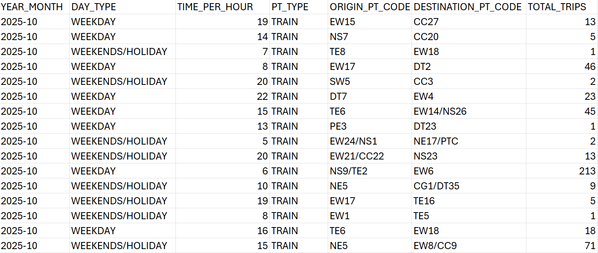
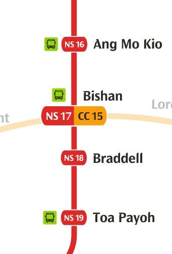
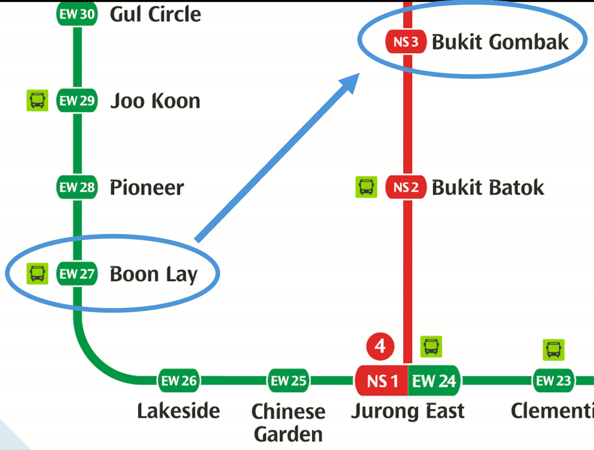
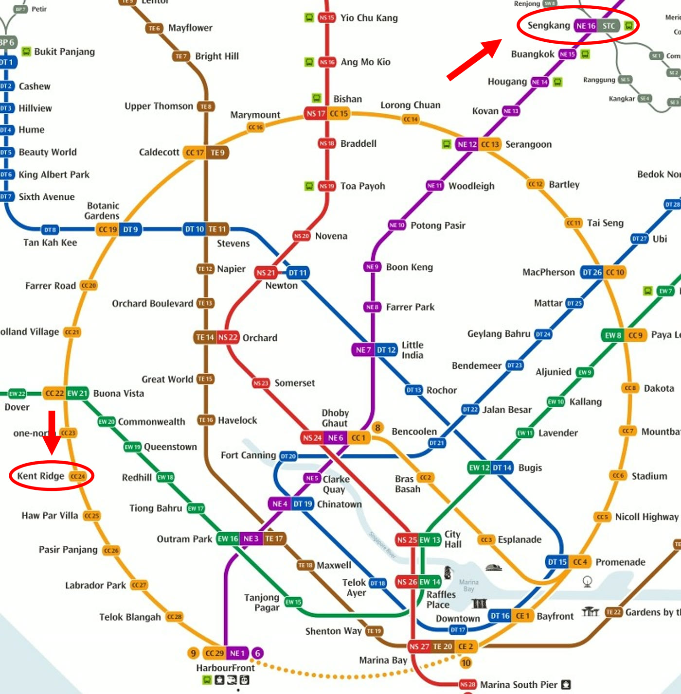
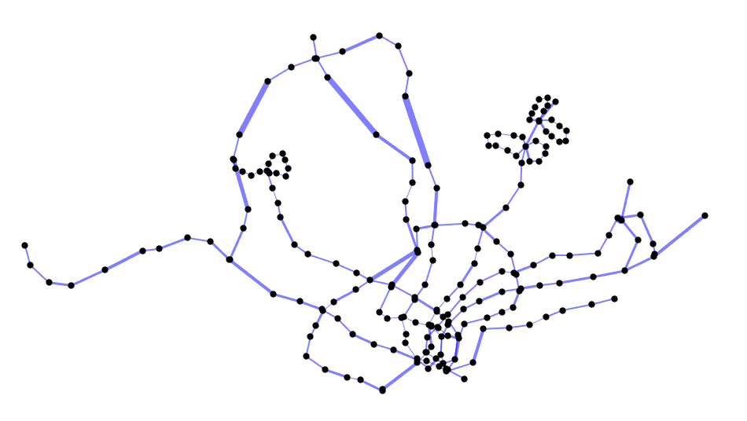

*Originally published on Medium as "[Appendix — Deep dive of Singapore's rail network passenger loads](https://medium.com/@simpletan/appendix-deep-dive-of-singapores-rail-network-passenger-loads-97868e987a16)" on 18 January 2026.*

::: {.tldr}
[TL;DR]{.tldr-title}

- LTA DataMall gives the number of trips between each pair of stations per hour, but not the route each passenger took.
- Each trip is assumed to take the quickest route, using station-to-station travel times plus interchange transfer times (walking time + 3 minutes of waiting).
- Dijkstra's algorithm finds that route for every station pair, and each trip's full count is assigned to every segment and transfer along it.
:::

*Update @ 22 Jan 2026: [u/ylyn](https://www.reddit.com/r/singapore/comments/1qg5lkw/comment/o0azv7q/) pointed out a crucial flaw in my original method when assigning passenger loads to segments, which I've corrected in the relevant sections.*

This article is the accompanying appendix of the main article! If you haven't already read that article, you may do so first (or scan through it, or read the TL;DR) before coming here for some context: [Deep dive of Singapore's rail network passenger loads](/posts/busiest-mrt-stations/).

We use the origin-destination (OD) passenger volume data obtained from [LTA DataMall](https://datamall.lta.gov.sg/), which gives the number of trips between MRT stop pairs, where they would tap in and out of the fare gantry. The data is given in terms of the number of trips completed in each hour of the day, with the days separated into two types of categories: weekdays, and weekends/public holidays.

{fig-alt="Spreadsheet rows with columns YEAR_MONTH, DAY_TYPE, TIME_PER_HOUR, PT_TYPE, ORIGIN_PT_CODE, DESTINATION_PT_CODE and TOTAL_TRIPS."}

## Breaking down the data

To break down the passenger loading in each trip in terms of adjacent MRT stations, we assign the total trips per origin-destination pair to each of the segments along the trip — where a segment is defined to be a trip between adjacent MRT stops.

{fig-alt="Section of the MRT map showing Toa Payoh, Braddell, Bishan and Ang Mo Kio on the North-South Line."}

For example, a data point in an hour slot for the passenger volume between Toa Payoh and Ang Mo Kio on the North-South Line (NSL) gives us 1000 trips (I'm using a made-up number here). In this journey, there are a total of 3 stops — Braddell, Bishan and finally Ang Mo Kio. We can then assign 1000 trips to each of the following trip segments:

1. Toa Payoh — Braddell
2. Braddell — Bishan
3. Bishan — Ang Mo Kio

This is because we know that these 1000 passengers are getting on at Toa Payoh, and only alighting at Ang Mo Kio. Hence the same number should remain during the hour slot for all of the segments.

## Trips with transfers

However, this data doesn't give the complete picture regarding transfers between different MRT lines. The most obvious indicator is when the origin and destination stations are on different lines, but it still lacks certain key information if we want to know

- Number of transfers
- The interchange stations and lines where the transfers occurred

This information is important because it allows us to break down a trip given by an origin-destination pair into their constituent sub-trips, or "legs", in different MRT lines. With this, we can assign a particular segment of an MRT line a more accurate figure for passenger load.

To illustrate this, let's use an example data point from Boon Lay MRT on the East-West Line (EWL) to Bukit Gombak MRT on the North-South Line (NSL), and the passenger volume is say, 1000 trips at 9am on weekdays.

{fig-alt="MRT map of the west, with Boon Lay on the East-West Line and Bukit Gombak on the North-South Line circled, connected via Jurong East."}

It's quite straightforward to say that the trip would look like this for all passengers:

1. Boon Lay to Jurong East on EWL — 3 stops
2. Transfer from EWL to NSL at Jurong East
3. Jurong East to Bukit Gombak on NSL — 2 stops

The trip essentially has 5 stops with a transfer in the middle. Using similar logic to the example with no transfers, we assign the same 1000 passenger load to each of these 5 segments, including the transfer at Jurong East.

## Trips with alternative transfers

The scenario that I just gave would be an example of a relatively straightforward trip to break down, because there aren't multiple transfers, and there is really no room for any other alternative route to get from Boon Lay to Bukit Gombak (which might change once the Jurong Region Line starts operating, but I digress).

One not so straightforward example would be a trip from Kent Ridge to Sengkang. Just by looking at the MRT system map again, there are two obvious routes that could work:

1. Kent Ridge to Serangoon on CCL, transfer to NEL, then Serangoon to Sengkang
2. Kent Ridge to HarbourFront on CCL, transfer to NEL, then HarbourFront to Sengkang

{fig-alt="Central section of the MRT map with Kent Ridge on the Circle Line and Sengkang on the North East Line circled."}

To determine the most "correct" route would not be a wise thing to do. After all, passengers have free will (funny to point it out like that but you get my drift) and can choose the route that they prefer the most. Maybe some would prefer going to HarbourFront first because there's a higher possibility of getting a seat from the terminus station for a longer second leg on the NEL. If the actual travel time between the two options were comparable, then it's easy to see how some people could value the comfort of sitting down over 5 minutes of time savings for the trip, for example. There could be many other subjective factors that influence the passengers' decision as well, such as crowdedness of trains, perceived air-conditioning strength, comfort in terms of stability and sound of the trains, ease of transfer at interchange stations — reasons could be endless.

## Travel duration

Nevertheless, for the purposes of analysis, we would need a more objective measure of the rational choice of route all passengers should take given a start and end station, assuming all passengers are rational. In short, we need an objective measure to decide on a unique route between any two stations in the network.

The most obvious objective metric for the decision making would be the total duration of the trip. A perfectly rational passenger who is always checking Google Maps or Citymapper for all of their MRT trips would always select the quickest route to their destination.

We would then need to have the travel time information between each adjacent station in the entire MRT network — which can be obtained as the train operators (SMRT, SBS Transit) publish that information either online or on the station travel information boards.

](nel-travel-times.jpg){fig-alt="North East Line diagram from HarbourFront to Punggol Coast with travel times of 1 to 4 minutes between stations."}

## Time taken for transfers

Another important piece of information that forms part of the duration of a trip would be the transfer times at each interchange station.

Not all interchange stations were built equal — the earlier stations like City Hall and Raffles Place were constructed with transfers in mind, as the EWL and NSL platforms are either opposite each other or just one short escalator ride away. Same for Bayfront. Some stations, like Bugis and Marina Bay, are not, requiring you to walk a long distance and traverse multiple escalators to complete the transfer, which can basically take up to 5 minutes (if you're not sprinting at top speed).

](bugis-travellator.jpg){fig-alt="Travellator in a long underground passage at Bugis MRT station."}

The interchange transfer time data is courtesy of Reddit user u/catcourtesy, who had measured the timing of each transfer between platforms of different lines by walking through the actual transfers. The actual data was published on a [Google Docs spreadsheet](https://docs.google.com/spreadsheets/d/1e-Tuf6rHBFsgsuFN7XqbFL8ec_vdRjQw/edit?gid=459175256#gid=459175256), and the transfer times were measured very systematically.

In reality, transfers also include the waiting time for the train on the next line. To account for this, I have added 3 minutes on average for all transfers.

When you look at the numbers, we can see that transfers can have a pretty heavy penalty in terms of time. Tampines for example has a walking transfer time of about 6 minutes. Adding the average waiting time gives a total of 9 minutes for the entire transfer. For an average 20-minute train ride, the transfer takes up almost half of the journey's duration — a very significant amount of time! So, it is intuitive that most passengers would like to minimise that, if it doesn't require a large detour to get to their destination.

## Determining the shortest route

By combining travel time between stations, and transfer time in interchange stations, we can build a [graph network](https://en.wikipedia.org/wiki/Graph_(discrete_mathematics)). The vertices will be the stations, and the edges connecting the vertices will be weighted with the duration needed to get between stations, as well as transfer between lines. Since the directionality of travel doesn't affect the travel time, the graph that is constructed is an undirected graph.

Note that interchange stations will have multiple vertices (e.g. Outram Park with 3 vertices for each station on the EWL, TEL and NEL, and 3 corresponding edges connecting each station pair) since we are treating each station on each line as a separate vertex.

Take a look at the overall connected graph of Singapore's MRT and LRT system below, with the thickness of the edges corresponding to the duration between stations — bonus points if you can identify the stations based on their locations.

{fig-alt="Network graph of all MRT and LRT stations as dots, connected by lines whose thickness reflects travel time."}

We can use [Dijkstra's algorithm](https://en.wikipedia.org/wiki/Dijkstra%27s_algorithm) to find the shortest path between two stations, which will give us the most rational route with transfers if the start and end stations are not on the same line. The table below shows an example route calculated from Tampines to Woodlands, starting on the Downtown Line (DTL) and transferring to the Circle Line (CCL) and then the North-South Line (NSL).

| # | Code | Station | Line | Time (min) |
|--:|:--|:--|:--|--:|
| 1 | DT32 | Tampines | [DTL]{.ln .ln-dtl} | 0 |
| 2 | DT31 | Tampines West | [DTL]{.ln .ln-dtl} | 2 |
| 3 | DT30 | Bedok Reservoir | [DTL]{.ln .ln-dtl} | 4 |
| 4 | DT29 | Bedok North | [DTL]{.ln .ln-dtl} | 6 |
| 5 | DT28 | Kaki Bukit | [DTL]{.ln .ln-dtl} | 8 |
| 6 | DT27 | Ubi | [DTL]{.ln .ln-dtl} | 10 |
| 7 | DT26 | MacPherson | [DTL]{.ln .ln-dtl} | 13 |
| 8 | CC10 | MacPherson | [CCL]{.ln .ln-ccl} | 18 |
| 9 | CC11 | Tai Seng | [CCL]{.ln .ln-ccl} | 20 |
| 10 | CC12 | Bartley | [CCL]{.ln .ln-ccl} | 22 |
| 11 | CC13 | Serangoon | [CCL]{.ln .ln-ccl} | 25 |
| 12 | CC14 | Lorong Chuan | [CCL]{.ln .ln-ccl} | 27 |
| 13 | CC15 | Bishan | [CCL]{.ln .ln-ccl} | 29 |
| 14 | NS17 | Bishan | [NSL]{.ln .ln-nsl} | 36 |
| 15 | NS16 | Ang Mo Kio | [NSL]{.ln .ln-nsl} | 40 |
| 16 | NS15 | Yio Chu Kang | [NSL]{.ln .ln-nsl} | 42 |
| 17 | NS14 | Khatib | [NSL]{.ln .ln-nsl} | 50 |
| 18 | NS13 | Yishun | [NSL]{.ln .ln-nsl} | 52 |
| 19 | NS12 | Canberra | [NSL]{.ln .ln-nsl} | 54 |
| 20 | NS11 | Sembawang | [NSL]{.ln .ln-nsl} | 56 |
| 21 | NS10 | Admiralty | [NSL]{.ln .ln-nsl} | 60 |
| 22 | NS9 | Woodlands | [NSL]{.ln .ln-nsl} | 62 |

: The fastest route from Tampines to Woodlands: 2 transfers, 22 stops and about 62 minutes. Time is cumulative from the start.

Having all of the possible journeys that one can make between each possible station pair in the MRT/LRT network, we can systematically break down the OD passenger volume data from LTA DataMall.

[Click here to go back to the analysis in the main article!](/posts/busiest-mrt-stations/)
